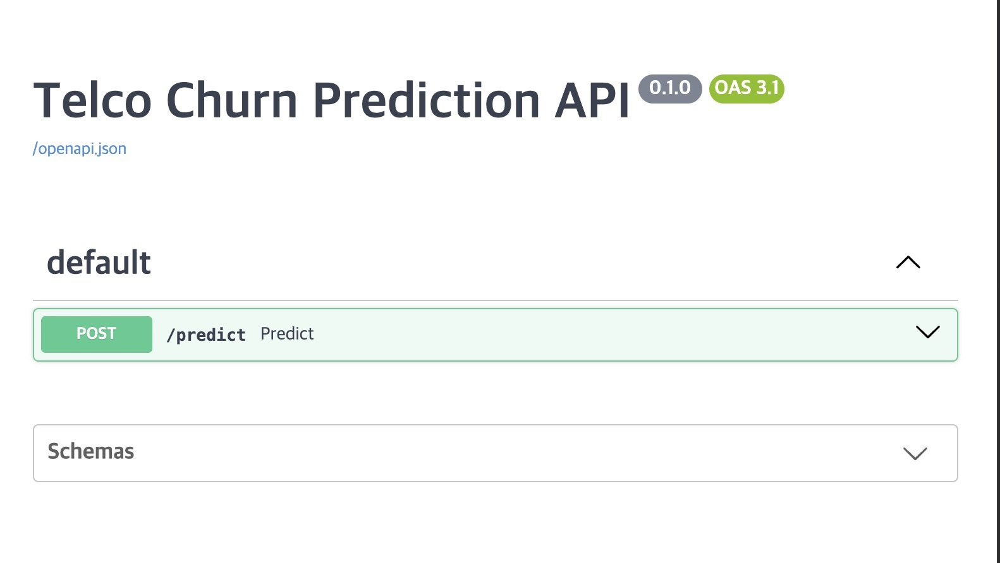
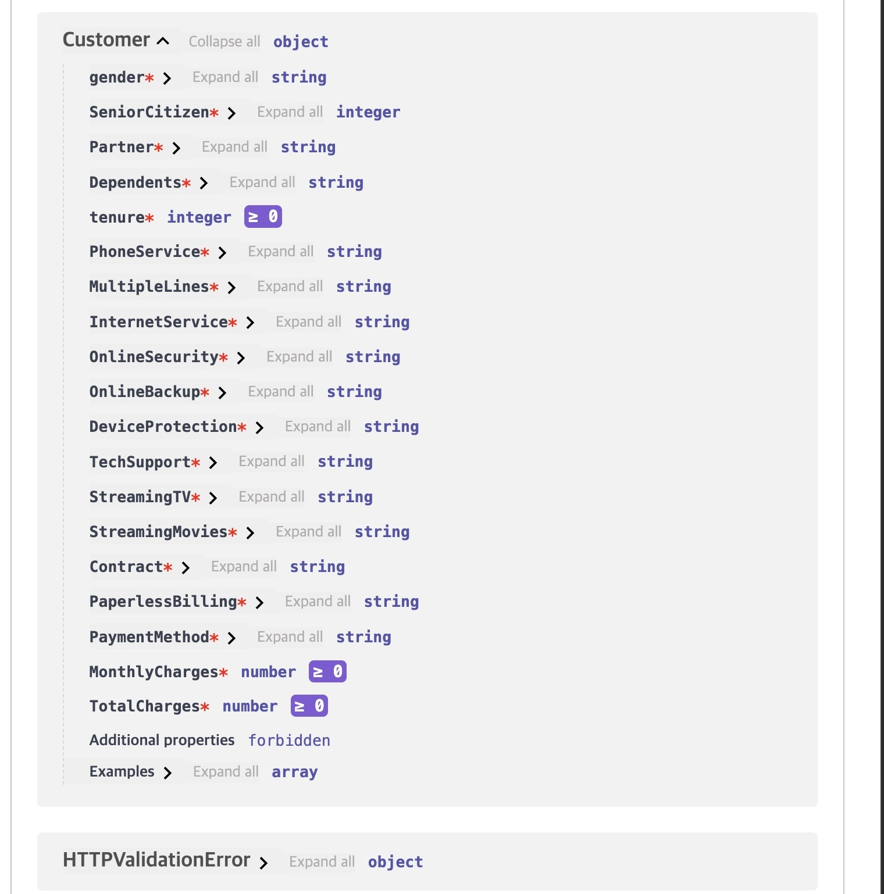
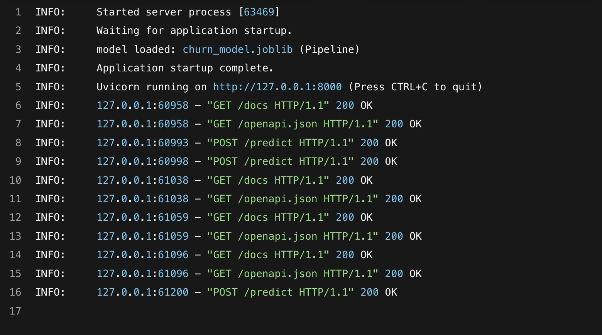
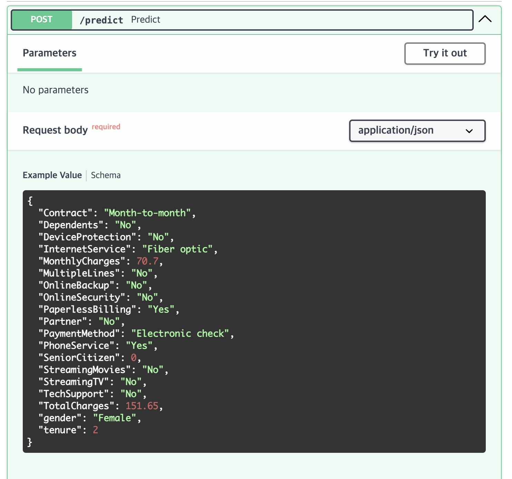
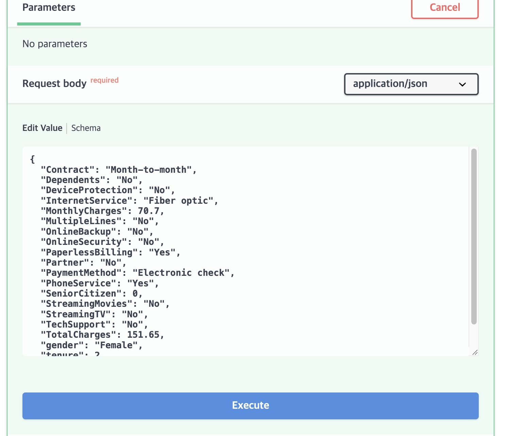
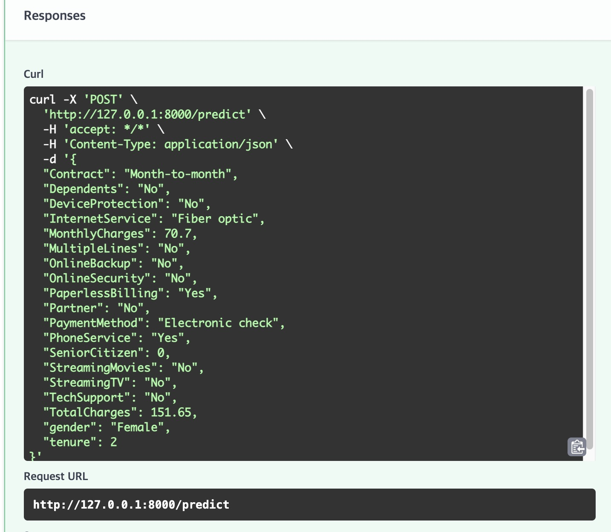
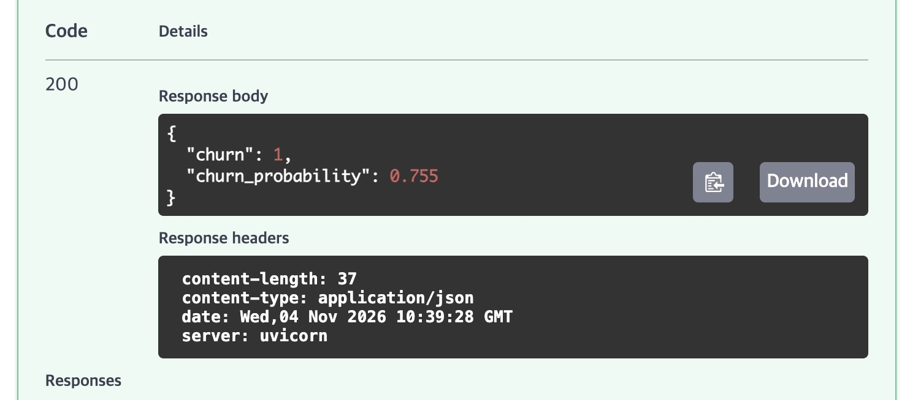
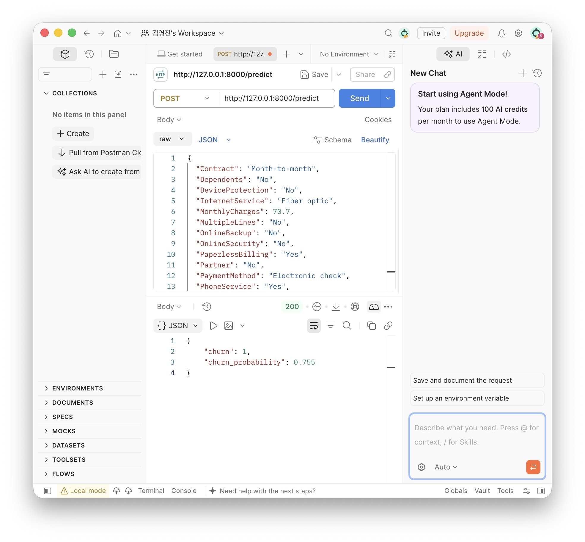

# 3조 - 2주차

git 실습

## 체크포인트별 결과

### 체크포인트 1: 조별 Repository 개설 및 1주차 결과물 Push

### 체크포인트 2: 조원 전원이 각자 Branch 생성 후 작업

### 체크포인트 3: 조원 전원이 PR 생성 및 최소 1건 Review Comment

### 체크포인트 4: 모든 PR Merge 완료

### 체크포인트 5: Merge Conflict 1건 이상 발생 및 해결

# 3조 - 4주차 (김영진)

## 체크포인트 1. FastAPI 서버 기동 및 Swagger 접속

## 체크포인트 2. 고객 정보 입력용 Pydantic 스키마 정의

## 체크포인트 3. churn_model.joblib 로드 및 /predict 구현

## 체크포인트 4. Swagger에서 예측 요청 성공

## 체크포인트 5. Postman으로 동일 요청 테스트

# 3조 - 4주차 (이지원)
## 체크포인트 1. FastAPI 서버 기동 및 Swagger 접속

## 체크포인트 2. 고객 정보 입력용 Pydantic 스키마 정의

## 체크포인트 3. churn_model.joblib 로드 및 /predict 구현

## 체크포인트 4. Swagger에서 예측 요청 성공

## 체크포인트 5. Postman으로 동일 요청 테스트

