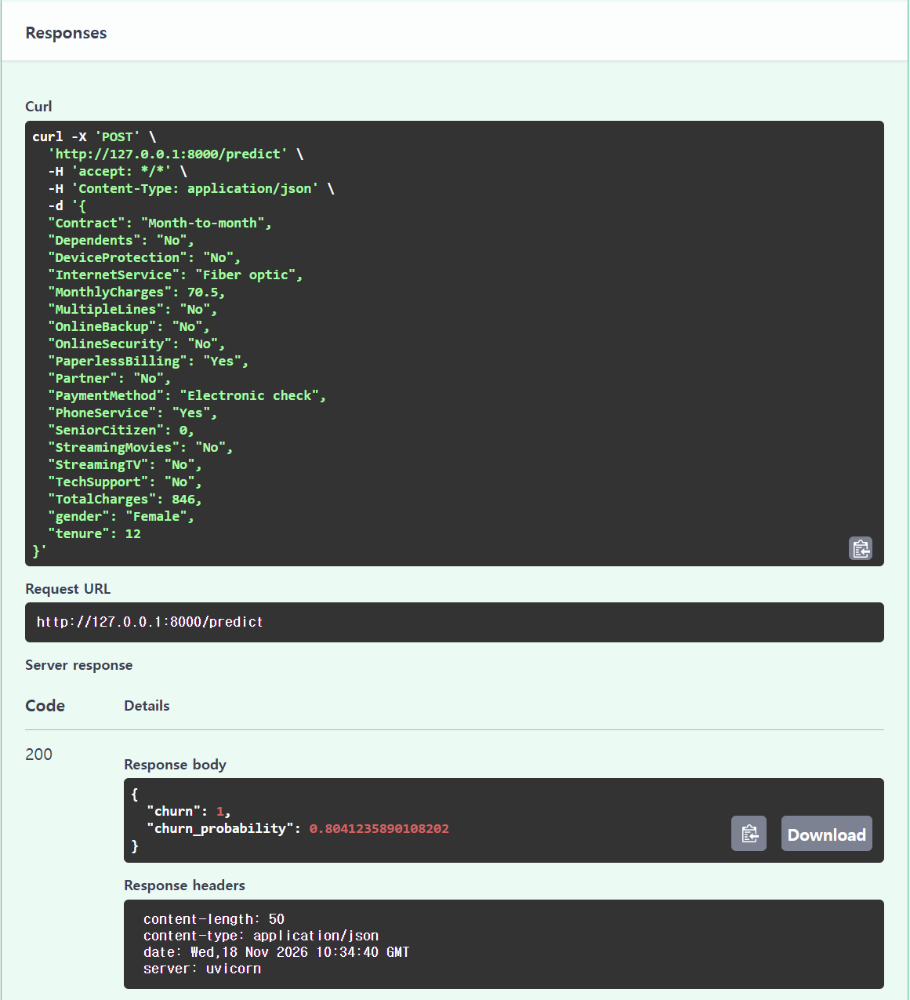
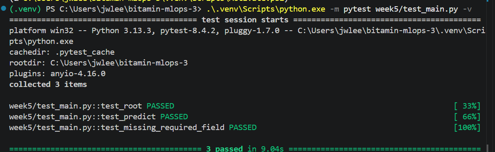
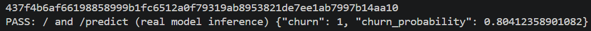
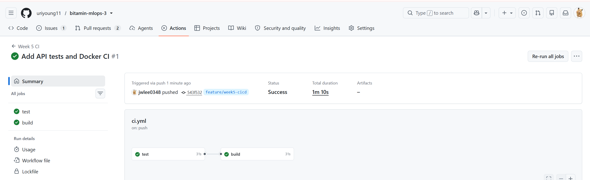
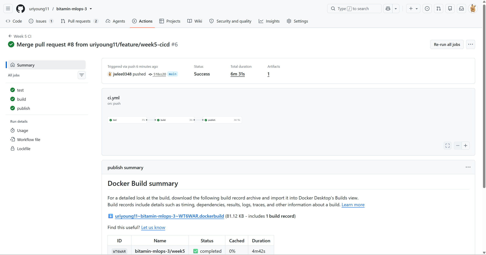
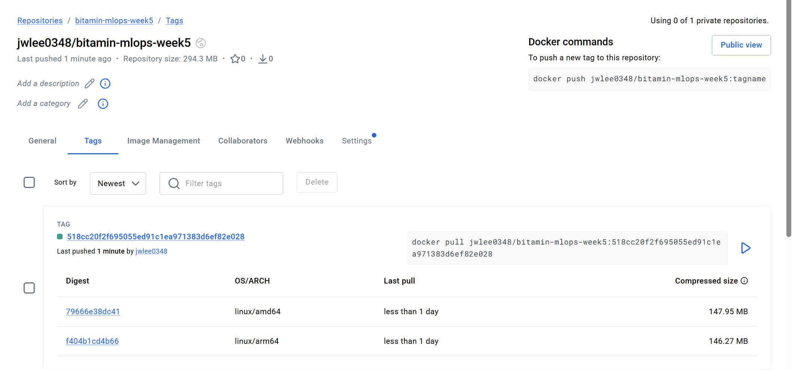
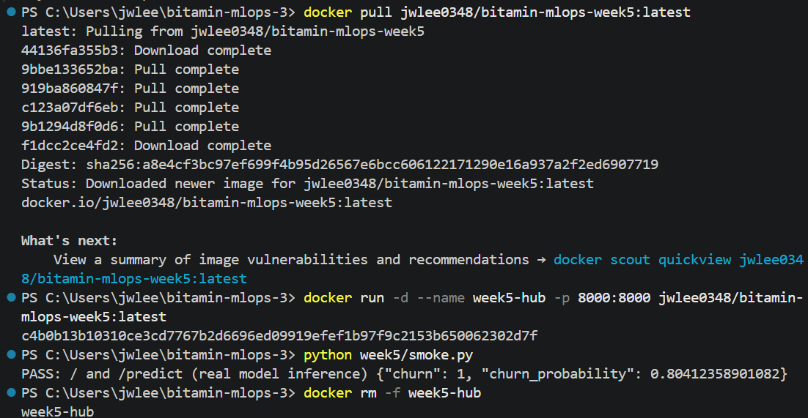

# Week 5 — Docker + GitHub Actions CI/CD 실습

### 결과 기록

- Actions 성공 실행 링크: https://github.com/uriyoung11/bitamin-mlops-3/actions/runs/44288757401
- Docker Hub 이미지 링크: https://hub.docker.com/r/jwlee0348/bitamin-mlops-week5
- 이미지 태그 / digest: `latest`, `518cc20f2f695055ed91c1ea971383d6ef82e028` (linux/amd64, linux/arm64) / `sha256:a8e4cf3bc97ef699f4b95d26567e6bcc606122171290e16a937a2f2ed6907719`
- CP1 캡처: 
- CP2 캡처: 
- CP3 캡처: 
- CP4 캡처: 
- CP5 캡처: publish 성공(Actions 실행 #6, main 커밋 `518cc20`) / Docker Hub Tags / pull한 이미지 smoke.py PASS
  - 
  - 
  - 
